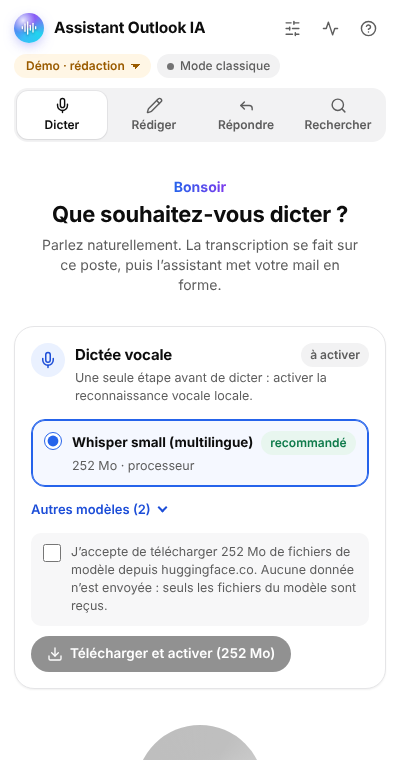
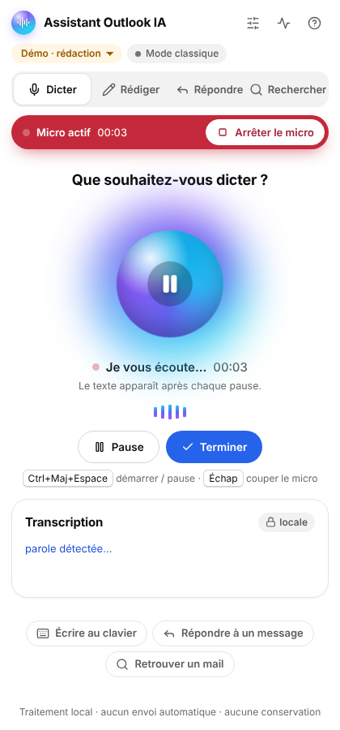
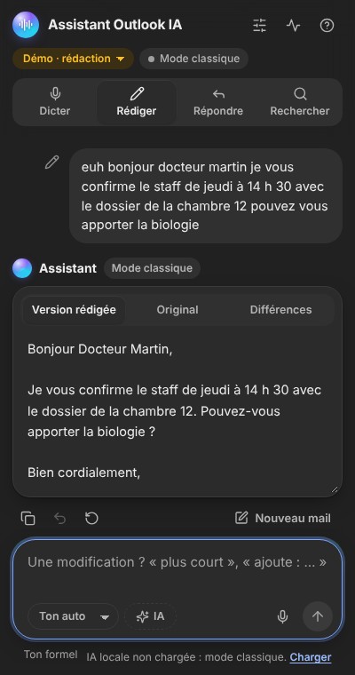
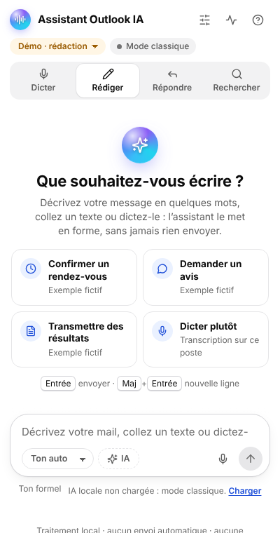
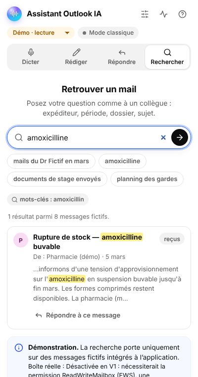
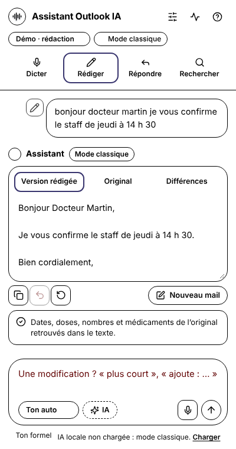
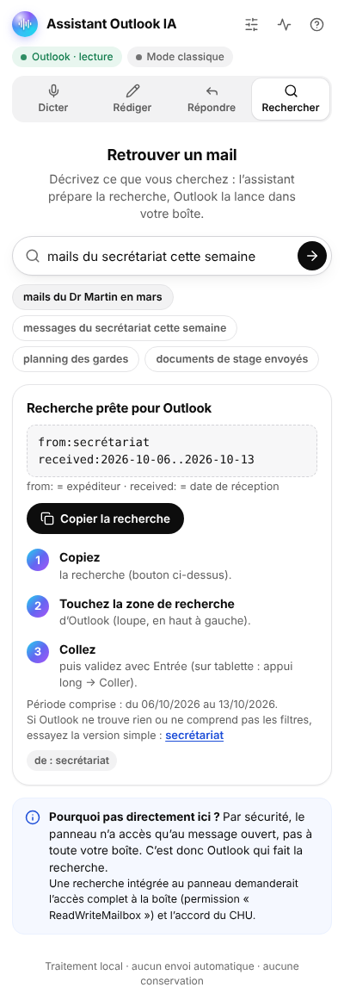
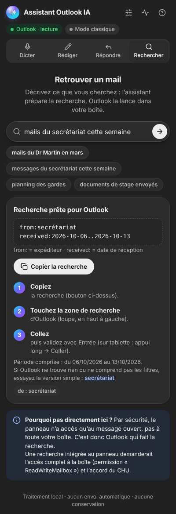

# Design — Assistant Outlook IA

Refonte réalisée lors de l'audit n°2 (2026-10-12). Objectif : une interface **accueillante**, **sobre et
futuriste**, dans l'esprit des messageries d'IA (ChatGPT) — tout en restant un outil médical prudent :
rien n'est envoyé, tout est vérifiable, l'utilisateur garde la main.

Captures (données fictives, panneau de 400 px) : [`docs/design/`](design/).

| Accueil (clair) | Dictée en cours (capture du test réel) | Rédiger (sombre) |
|---|---|---|
|  |  |  |
|  |  |  |
|  |  | |

## 1. Principes

1. **Une conversation, pas un formulaire.** Rédiger et Répondre se présentent comme un fil : votre texte à
   droite, la proposition de l'assistant à gauche, une zone de saisie en bas (Entrée pour envoyer).
2. **Accueillir.** Salutation selon l'heure et prénom de l'utilisateur (lu localement dans Outlook),
   suggestions d'exemples fictifs, langage simple, aucun jargon visible par défaut (détails techniques repliés).
3. **Montrer l'état sans ambiguïté.** Micro actif = bandeau rouge collé à l'en-tête, avec « Arrêter le micro »
   toujours visible ; calcul en cours = indicateur animé et bouton d'envoi transformé en **Arrêter**.
4. **Vérifier avant d'agir.** Sous chaque proposition : vérifications (dates, doses, nombres, médicaments),
   recalculées après chaque modification ; insertion seulement sur clic, envoi toujours manuel.
5. **Sobriété.** Surfaces blanches (ou gris anthracite), un seul accent « aurore » réservé aux éléments
   d'IA (orbe, avatar de l'assistant, barre de progression, logo).

## 2. Fondations

### Couleurs (jetons CSS, `src/styles.css`)

| Jeton | Clair | Sombre | Usage | Contraste vérifié |
|---|---|---|---|---|
| `--bg` | `#ffffff` | `#212121` | Fond | — |
| `--bg-elev` | `#ffffff` | `#2b2b2b` | Cartes, zone de saisie | — |
| `--surface-2` | `#f2f2f3` | `#303030` | Bulles, pistes segmentées | — |
| `--text` | `#0d0d0d` | `#ececec` | Texte principal | 19,4:1 / 13,6:1 |
| `--text-2` | `#5d5d5d` | `#b4b4b4` | Texte secondaire | 6,6:1 / 7,8:1 |
| `--text-3` | `#6b6b6b` | `#a3a3a3` | Indications | 5,3:1 / 5,2:1 (sur `#303030`) |
| `--primary` | `#0d0d0d` | `#ececec` | Bouton principal (texte inversé) | 19,4:1 / 16,5:1 |
| `--accent` | `#2563eb` | `#7aa7ff` | Focus, liens, sélection | 5,2:1 / 6,7:1 |
| `--ok` / `--warn` / `--danger` | `#0f7b4b` / `#9a5b00` / `#c4293b` | `#4ade80` / `#fbbf24` / `#f87171` | États | ≥ 4,8:1 sur leur fond pâle (clair) ; ≥ 5,5:1 (sombre) |
| `--rec` | `#c4293b` | idem | Bandeau « Micro actif » (texte blanc) | 5,6:1 |
| `--border-input` | `#949494` | `#858585` | Contour des champs | 3,0:1 / 3,8:1 (WCAG 1.4.11) |

Accent « aurore » : dégradé cyan `#22d3ee` → indigo `#6366f1` → violet `#a855f7` (et sa version conique
pour l'orbe). Jamais utilisé comme fond de texte courant.

### Typographie

`Segoe UI Variable` / `Segoe UI` (polices de Windows, déjà présentes sur les postes : aucun téléchargement),
repli `system-ui`. Corps 14 px, saisie 15 px, titres 15–22 px (graisse 650). Aucun texte sous 12 px.

### Formes, ombres, espacement

Rayons 10 / 14 / 20 / 26 px ; boutons et puces en pilule. Ombres très légères (`--shadow-sm/md/lg`).
Marges du panneau 14 px (10 px sous 360 px de large). Contenu centré, 760 px maximum en fenêtre large.

### Icônes

Jeu au trait (24 px, trait 2 px, extrémités arrondies) issu de **Lucide** (licence ISC, notice dans
`src/ui/icons.ts`), construit sans `innerHTML`. Toujours décoratives (`aria-hidden`) : le libellé est porté
par le texte ou par `aria-label`.

## 3. Composants

| Composant | Fichier | Comportement |
|---|---|---|
| En-tête | `src/ui/app.ts` | Collant, fond opaque, ombre au défilement ; logo-orbe, outils (Modèles, Diagnostic, Aide), badges d'état, bandeau micro. En démonstration, le badge de mode sert aussi de sélecteur (brouillon / message reçu). Le flou d'arrière-plan initial a été retiré après le test réel sur tablette (coûteux à chaque défilement). |
| Navigation segmentée | `src/ui/app.ts` | 4 sections principales ; icône au-dessus du libellé sous 400 px. |
| Orbe de dictée | `src/components/dictateView.ts` | Bouton principal (démarrer / pause / reprendre). Cœur conique qui tourne pendant l'écoute, halo qui suit le niveau sonore (`--level`), onde à 5 barres. Grisé tant que le modèle n'est pas chargé. |
| Zone de saisie | `src/components/composer.ts` | S'agrandit avec le texte ; outils à gauche (ton, IA), micro et bouton rond à droite ; Entrée envoie, Maj+Entrée va à la ligne ; pendant un calcul le bouton devient **Arrêter** (`aria-label` mis à jour). |
| Fil de discussion | `src/components/composeView.ts` | Bulle utilisateur (modifiable), notes de l'assistant, carte du mail (Version rédigée / Original / Différences), actions (copier, annuler, régénérer, nouveau mail), vérifications, modifications rapides, carte d'insertion. |
| Sélecteur segmenté | `src/components/segmented.ts` | `role="tablist"`, flèches gauche/droite, focus restauré après reconstruction. |
| Interrupteur | `src/ui/dom.ts` (`switchControl`) | Case à cocher native au rôle `switch` (lecteurs d'écran), piste et pastille animées. |
| Carte de modèle | `src/components/modelPanel.ts` | Langage clair (« Dictée vocale », taille, processeur ou carte graphique), recommandé en premier, autres modèles repliés dans Dicter, consentement explicite, progression en dégradé, repli vers plus léger. |
| Avatars | `src/components/avatar.ts` | Initiales et teinte stable par nom (décoratif). |
| Notifications | `src/ui/dom.ts` (`toast`) | Pilules sombres en bas, non cliquables (ne masquent jamais un bouton). |
| Recherche prête pour Outlook | `src/components/searchView.ts` | Dans Outlook : la question devient une recherche à coller (un filtre par bloc insécable), bouton « Copier la recherche », 3 étapes numérotées, légende des filtres, version simple de secours. |

## 4. Mouvement

Apparitions douces (0,25–0,3 s), orbe et onde pendant l'écoute, reflet animé sur « Rédaction… ».
**Aucune animation permanente au repos** : depuis le test réel sur tablette (2026-10-13, lenteurs de tout
l'appareil signalées), les effets continus (respiration de l'orbe, halo flou, flottement) et les flous
(`backdrop-filter`, `filter: blur`) ont été retirés ; les animations restantes ne tournent que pendant une
action (écoute, calcul, téléchargement).
`prefers-reduced-motion: reduce` : toutes les animations et transitions sont neutralisées.

## 5. Accessibilité

- WCAG 2.1 AA : **0 violation axe-core** sur les 7 vues, thèmes clair et sombre (`scripts/audit-ui.mjs`).
- Focus visible partout (anneau bleu ; anneau autour de la zone de saisie, de la recherche et des cartes radio).
- Annonces pour lecteurs d'écran (`announce()`) : changement de section, état du micro, mail rédigé,
  résultats de recherche, diagnostic — sans répétition du chronomètre.
- Mode **contraste élevé** de Windows (`forced-colors`) : contours explicites, fonds pleins, sélection
  signalée par `Highlight` (vérifié par capture).
- Cibles ≥ 24 px (cases et boutons radio inclus dans un libellé cliquable plus grand).

## 6. Vérifier le rendu

```bash
npm run build
node scripts/audit-ui.mjs audit-results   # axe, débordements, cibles, captures 320/450 px, clair/sombre
npm run e2e -- --asr whisper-small        # parcours réel (captures dans e2e-results/)
```
